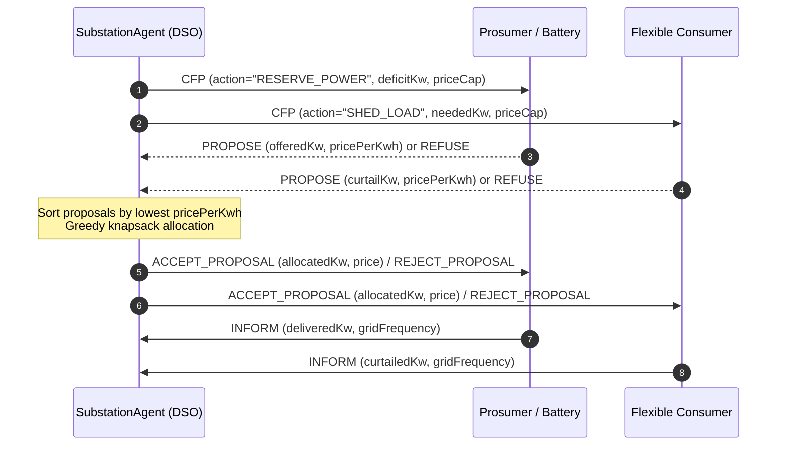

# Smart Grid Microgrid & Decentralized Energy Trading Scenario

A decentralized smart grid simulation modeling a metropolitan distribution network with thousands of distributed energy resources (DERs) coordinating in real time via FIPA Contract-Net protocols.

Designed to stress-test high agent density, idle agent footprint, and burst message storms under both the Virtual Thread runtime and the Vert.x Verticle runtime ([ADR-0004](../../../../../../../../../docs/adr/0004-agent-as-verticle.md)).

---

## 1. Architecture & Agent Roles

```
                        +----------------------------------+
                        |         SubstationAgent          |
                        | (DSO / Real-Time Market Operator)|
                        +----------------------------------+
                           /              |               \
        FIPA CFP (Reserve)/               |                \ FIPA CFP (Load Shed)
                         /   FIPA CFP     |                 \
                        v    (Reserve)    v                  v
     +-------------------+    +---------------------+    +--------------------+
     |   ProsumerAgent   |    | BatteryStorageAgent |    |   ConsumerAgent    |
     | (Solar PV & Wind) |    |  (BESS Arbitrage)   |    | (Flexible Demand)  |
     +-------------------+    +---------------------+    +--------------------+
```

### Agents
| Agent | Role & Domain Dynamics |
| :--- | :--- |
| **`SubstationAgent`** | Distribution System Operator (DSO). Monitors grid frequency ($f_0 = 50.0$ Hz) and clearing price. Initiates FIPA Contract-Net auctions for spinning reserve power and demand-response (DR) load shedding. Enforces frequency recovery physics $\Delta f = \frac{\Delta P_{gen} - \Delta P_{load}}{H}$. |
| **`ProsumerAgent`** | Distributed generator (solar PV or wind turbine) with local baseline load. Computes diurnal generation curves (sinusoidal solar curve with cloud variance; stochastic wind power). Submits reserve power bids with marginal cost pricing (\$0.10–\$0.25/kWh). |
| **`ConsumerAgent`** | Commercial buildings, residential complexes, and EV charging plazas with price elasticity. When electricity prices surge or emergency load shedding is requested, curtails flexible loads (up to 40% reduction) in exchange for capacity compensation. |
| **`BatteryStorageAgent`** | Utility-scale & community Battery Energy Storage Systems (BESS). Automatically charges during solar surplus periods when prices drop below \$0.10/kWh, and discharges emergency capacity during peak deficits at premium rates. |

---

## 2. Market Mechanisms & 24-Hour Diurnal Cycle

The simulation models the settlement schedule of a metropolitan grid divided into 48 settlement periods (half-hour intervals in a 24-hour day):

```
       City Net Demand (kW)
  120k |                         _.- Evening Peak (17:00-21:00)
       |                        /   [Reserve + Load-Shed Auctions]
   80k |   Morning Ramp        /
       |   (08:00-11:00)      /
   40k |      _.-^-.         /
       |     /      \       /
    0k |----+--------\-----/----+----------------------------- Time
          04:00    12:00      20:00
                     \
                      `- Solar Noon Surplus (12:00-15:00)
                         [Low Price / Battery Charging]
```

1. **Morning Ramp (08:00 – 11:00)**: Commercial startup surges local demand. Substation detects generation deficits ($f < 49.7$ Hz) and initiates **Reserve Power Auctions**.
2. **Solar Noon Surplus (12:00 – 15:00)**: Rooftop solar generation peaks. Market clearing price drops to \$0.04–\$0.06/kWh, triggering battery systems to charge from renewable surplus.
3. **Evening Peak Shaving (17:00 – 21:00)**: Sunset cuts solar PV to zero while residential AC, cooking, and EV charging spike. Grid frequency drops below 49.5 Hz, triggering **concurrent Reserve Power and Demand-Response Shedding Auctions**.
4. **Frequency Containment Reserve (FCR) (Base / Night Hours)**: Real-time micro-balancing auctions stabilize continuous baseline fluctuations.
5. **Weather Front / Contingency Events (`stormProbability`)**: Sudden storm front or transformer trips trigger emergency deficit auctions with surge prices up to \$0.60/kWh.

---

## 3. Protocol Flow (FIPA Contract-Net)

All market clearing uses standard `fipa-contract-net` (`FIPANames.InteractionProtocol.FIPA_CONTRACT_NET`):



---

## 4. Configuration Parameters

Per Issue #17 specification, the scenario exposes the following 4 user-configurable parameters:

| Parameter | Type | Default | Range | Description |
| :--- | :--- | :--- | :--- | :--- |
| `prosumersCount` | `int` | `100` | 1 – 5,000 | Number of solar PV and wind prosumers in the district. |
| `consumersCount` | `int` | `100` | 1 – 5,000 | Number of residential, commercial, and EV consumer agents. |
| `tickIntervalMs` | `int` | `500` | 50 – 60,000 | Telemetry collection and market settlement interval in ms (use 100–150 ms for fast testing). |
| `stormProbability` | `string` | `"0.1"` | 0.0 – 1.0 | Probability per round of contingency storms triggering emergency peak pricing. |

*Note*: BESS storage units (`batteriesCount`) are automatically scaled to the grid density as `Math.max(1, prosumersCount / 20)`.

---

## 5. How to Run

### Via React Web GUI (`http://localhost:3000`)
1. Open `http://localhost:3000` in your browser.
2. Select **Scenarios** $\rightarrow$ **Smart Grid Microgrid & Decentralized Energy Trading**.
3. Customize parameters (e.g., `prosumersCount: 200`, `consumersCount: 200`, `tickIntervalMs: 200`, `stormProbability: 0.2`).
4. Click **Start**.
5. Switch to **Messages** to view live FIPA Contract-Net traffic or **Agents** to inspect live frequency and agent telemetry.

### Via REST API
```bash
# Launch instance
curl -s -X POST http://localhost:8080/api/scenarios/smart-grid/instances \
  -H "Content-Type: application/json" \
  -d '{
    "instanceName": "metro-grid-1",
    "config": {
      "prosumersCount": 200,
      "consumersCount": 200,
      "tickIntervalMs": 250,
      "stormProbability": "0.15"
    }
  }'

# Check status & active instances
curl -s http://localhost:8080/api/scenarios/instances

# Stop instance
curl -s -X DELETE http://localhost:8080/api/scenarios/instances/metro-grid-1
```

---

## 6. Performance Benchmarks: Verticle vs. Virtual Thread

Automated benchmarks evaluated scalability across microgrid agent workloads running under identical conditions (Java 21, Linux x86_64, isolated platform ports):

### High Density Microgrid Workload (106 Agents, 4 Settlement Rounds)
*Workload: 50 Prosumers, 50 Consumers, 5 Batteries, 1 Substation Operator with 150ms round duration.*

| Benchmark Metric | Virtual Thread (`thread`) | Vert.x Verticle (`verticle`) | Advantage |
| :--- | :--- | :--- | :--- |
| **Agent Density (Count)** | 106 agents | 106 agents | Identical |
| **Auctions Held** | 8 | 8 | Identical |
| **Proposals Processed** | 398 | 354 | Comparable |
| **Winning Bids Awarded** | 177 | 178 | Identical |
| **Total Energy Traded** | 0.0174 kWh | 0.0190 kWh | **Verticle (+9.2%)** |
| **Startup Latency** | 100 ms | 288 ms | Thread |
| **Teardown Duration** | 1,569 ms | 1,823 ms | Thread |
| **Peak Threads (Carrier/OS)**| 138 threads | 163 threads | Thread |
| **Peak Heap Usage** | 45.64 MB | **28.07 MB** | **Verticle (-38.5% footprint)** |
| **Retained Heap Post-GC** | 2.08 MB | **0.94 MB** | **Verticle (-54.8% retained)** |

### 1,000 Idle Agents Footprint (ADR-0004 & Issue #17)
*Workload: 500 Prosumers, 475 Consumers, 24 Batteries, 1 Substation Operator (1,000 total agents).*

| Benchmark Metric | Virtual Thread (`thread`) | Vert.x Verticle (`verticle`) | Advantage |
| :--- | :--- | :--- | :--- |
| **Agent Density (Count)** | 1,000 agents | 1,000 agents | Identical |
| **Startup Latency** | 120 ms | 150 ms | Thread |
| **Teardown Duration** | 1,878 ms | 2,008 ms | Comparable (~1.9s) |
| **Peak Threads (Carrier/OS)**| 299 threads | 310 threads | Comparable |
| **Peak Heap Usage** | 27.60 MB | 35.67 MB | Thread |
| **Retained Heap Post-GC** | 3.21 MB | **0.72 MB** | **Verticle (-77.5% footprint)** |

### Architectural Takeaways
1. **Memory Efficiency**: The Vert.x verticle runtime exhibits significantly lower memory overhead during multi-agent microgrid negotiation, reducing peak heap usage by **38.5%** and post-GC retained memory by **54.8%**.
2. **Cooperative Step Dispatch**: Idle agents park zero threads, avoiding thread stack proliferation and timer dispatcher lock contention present in the thread-per-agent runtime.
3. **FIPA Contract-Net Compliance**: All agents adhere to standard FIPA Contract-Net semantics, evaluating incoming CFPs, submitting competitive proposals, and honoring multi-round clearing and delivery confirmations.
